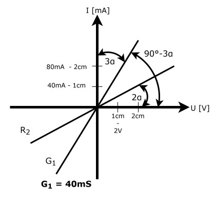
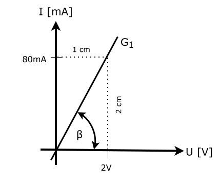
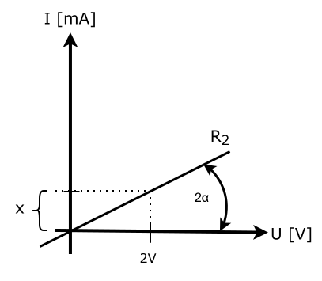

# 1.1. feladat {.unnumbered}

Határozza meg $R_2$ értékét, ha az abszcissza tengelyen $1 cm$ $2 V$-nak, az ordináta tengelyen
pedig $40 mA$-nek felel meg!

{#fig-1.1. width=50%}

::: {.callout-tip collapse="true"}
## Megoldás

$R_2 = 156,593 Ω$

:::

::: {.callout-note collapse="true"}
## Levezetés

Célunk $R_2$ kiszámítása, ehhez szükségünk van a függvény által bezárt szögre, amit $G_1$ segítségével tudunk kiszámolni.

$$
G_1 = \frac{I_1}{U_1}
$$

Behelyettesítjük $G_1$ értékét. Mivel az $U$ tengelyen $1 cm = 2 V$, kiszámítjuk az áramerősséget erre a pontra.

$$
40 mS = \frac{I_1}{2 V}
$$

$$
I_1 = 40 mS \cdot 2 V = 80 mA
$$

Mivel ez éppen az $I$ tengely 2 cm-es pontja, így a $G_1$ függvény átmegy a (1cm; 2cm) ponton. Ennek a pontnak a segítségével derékszögű háromszöget veszünk fel, ahol $β = 90°-3α$.

{#fig-1.1.2 width=50%}

$$
tg(β) = \frac{2cm}{1cm} = 2
$$

$$
β = 63,435° = 90°-3α
$$

$$
α = 8,855°
$$

$R_2$ által bezárt szög $2α = 17,71°$. Vegyünk fel egy háromszöget hasonlóképpen az előzőhöz, pl. az $U$ tengelyen $1 cm$-nél.

{#fig-1.1.3 width=50%}

$$
tg(2α) = \frac{x}{1cm}
$$

$$
x = 1 cm \cdot tg(2α) = 0,3193 cm
$$

Ez az $I$ skálán:

$$
I_2 = 0,3193 \cdot 40 mA = 12,772 mA
$$

$$
R_2 = \frac{2 V}{12,772 mA} = 156,593 Ω 
$$

:::

